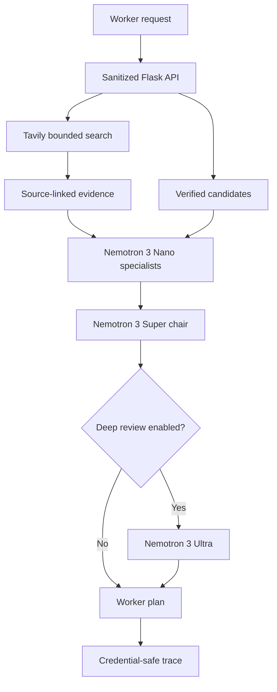

# Uberedge — Nemotron Opportunity Council

**Nebius x NVIDIA Global AI Hackathon · Best Apps and Agents**

Uberedge is a worker-first planning agent for rideshare, food-delivery, and grocery workers. It combines bounded public web evidence with a fault-tolerant NVIDIA Nemotron council to build explainable shift plans that reduce unpaid waiting and empty mileage.

> This is the sanitized public-submission repository. Production credentials, vendor-specific hosting details, database internals, private operational configuration, and the original visual design system are intentionally excluded. The included frontend is a functional placeholder.

## Hackathon requirements

- **NVIDIA open model:** NVIDIA Nemotron 3 Nano, Super, and optional Ultra.
- **Nebius runtime:** all council inference is sent to the Nebius Token Factory OpenAI-compatible API.
- **Open-source license:** MIT, an OSI-approved license.
- **Reproducible project:** simple local setup, tests, health endpoint, and a live planning API.
- **Current web evidence:** Tavily Search supplies bounded excerpts with source URLs.
- **Hosting:** the application can run on a selected cloud while qualifying Nemotron inference runs through Nebius Token Factory.

## How NVIDIA Nemotron is used

Uberedge does not make one opaque model call. It runs a council of specialized agents:

| Role | NVIDIA model tier | Responsibility |
|---|---|---|
| Demand Scout | Nemotron 3 Nano | Finds strong time-bounded crowd and task transitions |
| Route Economist | Nemotron 3 Nano | Compares waiting, empty travel, utilization, and net value per mile |
| Worker Advocate | Nemotron 3 Nano | Rejects unsafe, fragile, or vehicle-intensive plans |
| Evidence Auditor | Nemotron 3 Nano | Challenges unsupported claims and false precision |
| Council Chair | Nemotron 3 Super | Resolves disagreements and synthesizes one feasible plan |
| Deep Reviewer | Nemotron 3 Ultra, optional | Reviews difficult or high-uncertainty plans |

The four Nano specialists run concurrently. If one specialist fails, the council can continue when enough independent reports remain. Super is reserved for cross-agent synthesis; Ultra is opt-in so credits are spent only when deeper review is useful.

## Where Nebius Token Factory accelerated the workflow

Nebius Token Factory made the transition from a single-model prototype to a multi-agent system practical:

1. **OpenAI-compatible interface:** the project uses a standard chat-completions boundary instead of maintaining a separate model-serving stack.
2. **Model ladder:** Nano handles fast specialist calls, Super handles synthesis, and Ultra handles optional deep review.
3. **Parallel throughput:** four specialist calls execute concurrently, reducing end-to-end latency compared with a sequential council.
4. **Credit efficiency:** inexpensive fast calls handle routine analysis while stronger models are reserved for aggregation and escalation.
5. **Operational telemetry:** usage metadata supports a credential-safe trace with model, role, latency, prompt tokens, completion tokens, total tokens, status, and run ID.
6. **Portable hosting:** the web application may remain on a selected cloud while NVIDIA inference is performed through Token Factory.

**Nebius Token Factory is the Nebius service used by this working public edition.** This repository does not claim that Nebius Serverless Endpoints or Serverless Jobs are currently deployed.

## How Tavily is used

Before the Nemotron council starts, Uberedge sends one bounded query to Tavily Search. Tavily returns concise public-web excerpts and source URLs.

Retrieved text is treated as **untrusted evidence**, not as instructions:

- excerpts cannot override verified user-supplied candidates;
- agents are told to ignore instructions found inside retrieved content;
- web claims retain their URLs;
- the Evidence Auditor challenges weak or contradictory claims;
- if Tavily fails, the council continues from the verified input;
- Tavily status, latency, result count, and URLs appear in the safe trace, but its API key never does.

## Architecture



### Request lifecycle

1. Validate and bound the worker request.
2. Retrieve a small Tavily evidence packet.
3. Label every excerpt as untrusted and preserve its URL.
4. Fan the combined context out to four concurrent Nemotron 3 Nano specialists.
5. Require at least two successful specialist reports.
6. Ask Nemotron 3 Super to resolve disagreements and produce one concise plan.
7. Optionally send the draft to Nemotron 3 Ultra.
8. Return the plan and a secret-free execution trace.

## Golden metric

Uberedge optimizes **risk-adjusted net value per mile**, rather than gross revenue:

```text
(task revenue + food savings - operating costs) / total miles
```

The final plan must disclose uncertainty, avoid earnings guarantees, include a fallback, and identify facts the worker should verify.

## Quick setup

### Requirements

- Python 3.12 or later
- [uv](https://docs.astral.sh/uv/)
- Nebius Token Factory API key
- Tavily API key, optional but recommended

### Install and run

```bash
git clone https://github.com/kwyip/uberedge_nebius_devpost.git
cd uberedge_nebius_devpost
cp .env.example .env
uv sync
```

Set the two server-side keys in your shell or secure secret manager:

```bash
export NEBIUS_API_KEY='replace-with-token-factory-key'
export TAVILY_API_KEY='replace-with-tavily-key'
```

Start the placeholder application:

```bash
uv run flask --app app run --host 0.0.0.0 --port 5173
```

Open `http://127.0.0.1:5173`.

### Test the planning API

```bash
curl -s http://127.0.0.1:5173/api/v1/plan \
  -H 'Content-Type: application/json' \
  -d '{
    "prompt": "Boston shift, 5:00 PM-9:00 PM. Verified candidate: a public event ends at 6:30 PM three estimated miles away. Exact revenue is unknown. Build a cautious plan."
  }' | python -m json.tool
```

### Run tests

```bash
uv run pytest -q
```

## Configuration

| Variable | Purpose | Default |
|---|---|---|
| `NEBIUS_API_KEY` | Nebius Token Factory credential | required |
| `NEBIUS_BASE_URL` | Token Factory OpenAI-compatible base URL | Token Factory US Central endpoint |
| `NEMOTRON_FAST_MODEL` | Parallel specialist model | Nemotron 3 Nano |
| `NEMOTRON_REASONING_MODEL` | Council synthesis model | Nemotron 3 Super |
| `NEMOTRON_DEEP_MODEL` | Optional review model | Nemotron 3 Ultra |
| `NEBIUS_USE_DEEP_REVIEW` | Enable Ultra review | `0` |
| `TAVILY_API_KEY` | Tavily Search credential | optional |
| `TAVILY_SEARCH_DEPTH` | Tavily search mode | `advanced` |
| `TAVILY_MAX_RESULTS` | Maximum evidence excerpts | `5` |

Never commit a real API key. Keys stay server-side and are excluded from responses and traces.

## Public-repository disclosure

This repository is intentionally scoped to the hackathon evaluation surface:

- the Nemotron council and Tavily orchestration are implemented and testable;
- the UI uses generic placeholder HTML and CSS;
- map integration is represented only as a selected map-service adapter;
- hosting is described only as a selected cloud;
- private database schemas, billing implementation, deployment addresses, internal accounts, and production operations are omitted;
- production styling, layout tokens, branded assets, and detailed interaction behavior are not included.

These omissions do not change the qualifying runtime: NVIDIA Nemotron inference is executed through Nebius Token Factory.

## Significant update during the submission period

Uberedge existed before the submission period as a forecasting prototype. During the hackathon it was substantially rebuilt around a fault-tolerant Nemotron council on Nebius Token Factory, with concurrent specialists, Super synthesis, optional Ultra escalation, Tavily evidence grounding, partial-failure tolerance, secret-safe traces, tests, and public technical documentation.

## Repository layout

```text
app.py                    sanitized Flask API and placeholder page
nebius_agents.py          Tavily + Nemotron council orchestration
templates/index.html      deliberately generic frontend
static/placeholder.css    deliberately generic styles
scripts/demo_nebius.py    judge-facing command-line demonstration
tests/                    orchestration and API tests
.env.example              non-secret configuration template
```

## License

Released under the [MIT License](LICENSE).
